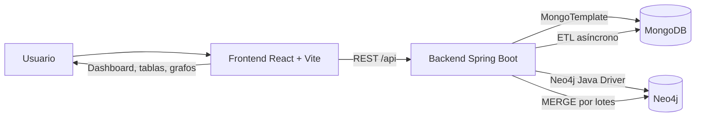
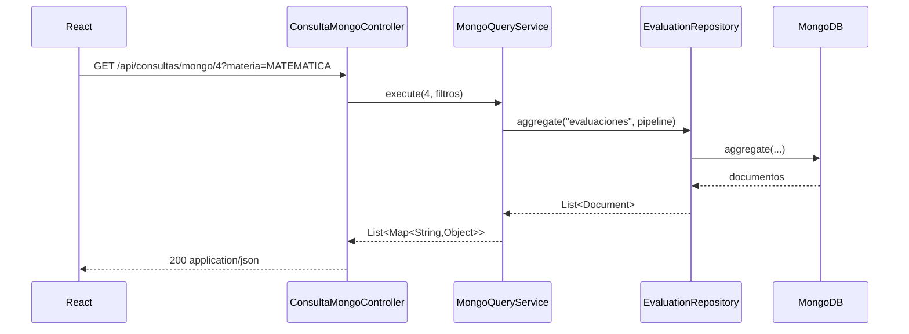
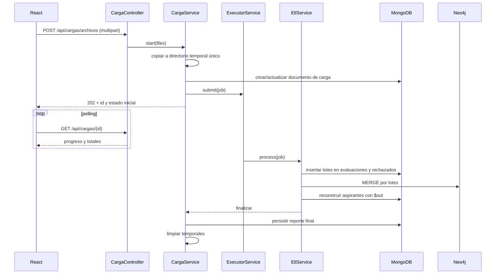

# Arquitectura de la solución

## 1. Visión general

La aplicación sigue una arquitectura en tres capas principales: **presentación (React)**, **aplicación (Spring Boot)** y **persistencia poliglota (MongoDB + Neo4j)**. El navegador nunca se conecta directamente a las bases de datos.



### Componentes

| Componente | Responsabilidad |
|---|---|
| `frontend-proyecto-final-db2/` | Interfaz, navegación, filtros, gráficas, tablas, carga de archivos, explorador de grafos. |
| `controller/` | Expone endpoints REST, valida parámetros de entrada y delega en servicios. |
| `service/` | Reglas de negocio, ETL, consultas analíticas, búsqueda, catálogos y consultas Cypher. |
| `repository/` | Acceso a MongoDB con `MongoTemplate` y documentos BSON dinámicos. |
| `neo4j/` | Catálogo centralizado de sentencias Cypher, restricciones e índices. |
| `dto/`, `exception/` | Contratos de respuesta y traducción de errores a mensajes claros en español. |
| `util/` | Utilidades de CSV, conversión BSON/JSON y formato. |

## 2. Flujo de una petición REST

1. El componente React llama a `api.get(...)` o `api.post(...)` usando Axios.
2. En desarrollo, Vite redirige `/api` a `http://localhost:8080`.
3. El controlador recibe la petición y construye un objeto de filtros.
4. El servicio ejecuta la consulta o el proceso correspondiente.
5. El repositorio devuelve documentos BSON; `MongoJson` los transforma en mapas serializables.
6. Spring serializa la respuesta a JSON.
7. El frontend muestra gráfica, tabla, ficha o mensaje de error.

Ejemplo: `GET /api/consultas/mongo/4?materia=MATEMATICA`.



## 3. Flujo del ETL asíncrono

La carga no bloquea la petición HTTP. El endpoint responde `202 Accepted` y el procesamiento continúa en un pool dedicado.



### Decisiones clave

- **Dos bases, una fuente de verdad:** `evaluaciones` es la fuente plana; `aspirantes` se reconstruye desde ella; `resumen_carrera` se regenera con `$merge`. Neo4j se carga con `MERGE` para que reintentos no dupliquen nodos.
- **Idempotencia:** el índice único sobre `hash_fila` evita duplicados exactos. El hash se calcula con los campos normalizados de la fila.
- **Tolerancia a fallos:** si una fila falla, se registra en `registros_rechazados` y el archivo continúa. Si falla una base, el job termina en `ERROR` o `EXITOSA_CON_RECHAZOS` y el frontend muestra el detalle.
- **Consultas dinámicas:** los pipelines se construyen con `org.bson.Document`, lo que permite combinar filtros sin repositorios fuertemente tipados.
- **Configuración externa:** MongoDB, Neo4j, CORS y tamaño de lote se configuran por variables de entorno.

## 4. Capas del backend

```text
com.db2.proyectofinaldb2
├── config/        CORS, executor, inicializadores de índices/restricciones
├── controller/    API REST
├── dto/           Respuestas de carga y grafos
├── exception/     ApiException + manejador global
├── neo4j/         CypherCatalog
├── repository/    EvaluationRepository (MongoTemplate)
├── service/       ETL, consultas, grafos, búsqueda, catálogos
└── util/          CsvSupport, MongoJson
```

Reglas:

- Los controladores no contienen lógica de negocio ni pipelines.
- Los servicios no exponen `Document` directamente al frontend; se convierten a mapas.
- Las sentencias Cypher viven en `CypherCatalog` para facilitar su auditoría y exposición en la defensa.
- Los mensajes al usuario están en español; los nombres de clases, métodos y variables en inglés.

## 5. Frontend

```text
frontend-proyecto-final-db2/src
├── api/client.js          Axios + normalización de errores
├── components/            Layout, gráficas, tablas, filtros, canvas, upload
├── hooks/                 useConsultas, useCarga, useCatalogos
├── pages/                 Dashboard, Carga, Consultas, Grafos, Buscador, 404
├── utils/formato.js       Números, fechas, porcentajes, CSV
└── styles.css             Diseño responsive
```

- `useConsultas` centraliza loading, error y recarga de las 20 consultas.
- `useCatalogos` carga materias, carreras, departamentos, municipios, tipos y años para los selects.
- `GrafoCanvas` usa `react-force-graph-2d`; al hacer clic en un nodo se consulta `/api/grafo/nodo/{id}`.
- `TablaResultados` ofrece paginación, orden, exportación CSV y formatos según el tipo de columna.

## 6. Despliegue local

```text
Docker Compose
├── db2-mongo    → puerto 27017
└── db2-neo4j    → puertos 7474 (HTTP) y 7687 (Bolt)

Backend Spring Boot → puerto 8080
Frontend Vite       → puerto 5173
```

Para producción se recomienda:

1. Compilar el frontend con `npm run build`.
2. Servir `frontend-proyecto-final-db2/dist` desde Nginx o desde el propio backend.
3. Configurar `VITE_API_URL` o un proxy `/api`.
4. Cambiar credenciales de Neo4j y aislar los puertos de las bases de datos.
5. Ejecutar el backend empaquetado con `java -jar target/proyecto-final-db2-0.0.1-SNAPSHOT.jar`.

## 7. Justificación de la arquitectura

- **Separación frontend/backend:** permite probar la API de forma independiente y desplegar la interfaz como estáticos.
- **MongoDB para analítica:** los pipelines de agregación resuelven agrupaciones, porcentajes, ventanas y resúmenes con pocas etapas y buen rendimiento sobre documentos.
- **Neo4j para relaciones:** los recorridos de aspirante → institución → municipio → departamento y aspirante → evaluación → materia → carrera son naturales en Cypher y costosos de expresar con múltiples `$lookup`.
- **Modelo políglota:** cada base resuelve el tipo de pregunta para la que fue diseñada; la aplicación mantiene ambas sincronizadas desde el mismo ETL.
