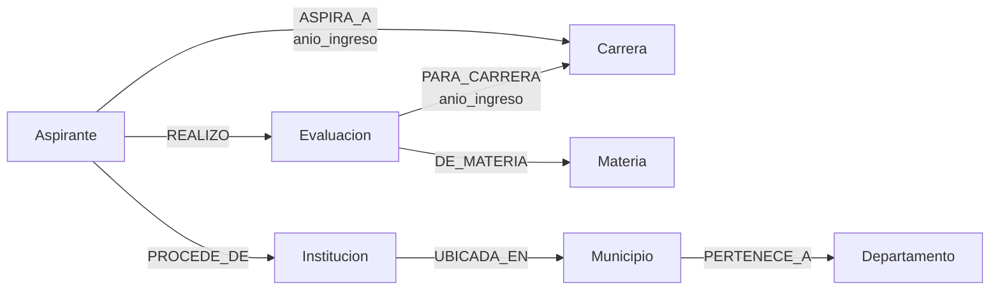

# Modelamiento de datos en Neo4j

## 1. ¿Por qué un grafo?

MongoDB responde bien preguntas de agregación, pero las preguntas relacionales del proyecto son más naturales como recorridos:

- ¿qué aspirantes de un departamento aspiran a una carrera?;
- ¿qué aspirantes comparten institución educativa?;
- ¿qué materias comparten dos carreras?;
- ¿qué camino conecta un departamento con una carrera?;
- ¿cuál es el subgrafo alrededor de un aspirante, una institución o una evaluación?

En Neo4j cada una de esas preguntas se expresa con patrones Cypher y recorridos de longitud variable, sin `JOIN` múltiples.

## 2. Modelo de nodos

| Etiqueta | Propiedades principales | Clave / restricción |
|---|---|---|
| `Aspirante` | `correlativo`, `sexo`, `anio_nacimiento`, `created_at` | `correlativo` único |
| `Carrera` | `nombre` | `nombre` único |
| `Materia` | `nombre` | `nombre` único |
| `Departamento` | `nombre` | `nombre` único |
| `Municipio` | `key`, `nombre`, `departamento` | `key` única (`departamento|municipio`) |
| `Institucion` | `key`, `tipo`, `municipio`, `departamento`, `nombre` | `key` única (`tipo|municipio|departamento`) |
| `Evaluacion` | `key`, `correlativo_aspirante`, `materia`, `anio_ingreso`, `oportunidad`, `aprobacion`, `aprobado`, `edad_ingreso`, `fecha_asignacion`, `created_at` | `key` única (`correlativo|materia|año|oportunidad`) |

### Nota sobre `Institucion`

El dataset de pruebas específicas **no incluye el nombre del establecimiento educativo**; solo el tipo, el municipio y el departamento. Para no inventar un nombre, la institución se modela como una combinación normalizada:

```text
clave = tipo_ie + "|" + municipio_ie + "|" + departamento_ie
nombre = tipo_ie + " - " + municipio_ie + " - " + departamento_ie
```

Esto evita duplicar instituciones cuando varios aspirantes comparten el mismo tipo y ubicación. Si en el futuro se incorpora el nombre real, basta con ampliar la clave y el ETL; las consultas Cypher no cambian.

## 3. Modelo de relaciones

| Relación | Origen → destino | Propiedades | Significado |
|---|---|---|---|
| `ASPIRA_A` | `Aspirante` → `Carrera` | `anio_ingreso` | Carrera objetivo del aspirante en un año. |
| `REALIZO` | `Aspirante` → `Evaluacion` | — | El aspirante realizó esa evaluación. |
| `DE_MATERIA` | `Evaluacion` → `Materia` | — | Materia evaluada. |
| `PARA_CARRERA` | `Evaluacion` → `Carrera` | `anio_ingreso` | La evaluación corresponde a la carrera objetivo. |
| `PROCEDE_DE` | `Aspirante` → `Institucion` | — | Institución educativa de procedencia. |
| `UBICADA_EN` | `Institucion` → `Municipio` | — | Ubicación de la institución. |
| `PERTENECE_A` | `Municipio` → `Departamento` | — | Jerarquía geográfica. |

### Diagrama



## 4. Restricciones e índices

`CypherCatalog.CONSTRAINTS` crea al arrancar:

```cypher
CREATE CONSTRAINT aspirante_correlativo IF NOT EXISTS
FOR (a:Aspirante) REQUIRE a.correlativo IS UNIQUE;

CREATE CONSTRAINT carrera_nombre IF NOT EXISTS
FOR (c:Carrera) REQUIRE c.nombre IS UNIQUE;

CREATE CONSTRAINT materia_nombre IF NOT EXISTS
FOR (m:Materia) REQUIRE m.nombre IS UNIQUE;

CREATE CONSTRAINT departamento_nombre IF NOT EXISTS
FOR (d:Departamento) REQUIRE d.nombre IS UNIQUE;

CREATE CONSTRAINT municipio_key IF NOT EXISTS
FOR (m:Municipio) REQUIRE m.key IS UNIQUE;

CREATE CONSTRAINT institucion_key IF NOT EXISTS
FOR (i:Institucion) REQUIRE i.key IS UNIQUE;

CREATE CONSTRAINT evaluacion_key IF NOT EXISTS
FOR (e:Evaluacion) REQUIRE e.key IS UNIQUE;
```

Índices de apoyo:

```cypher
CREATE INDEX evaluacion_aprobado IF NOT EXISTS FOR (e:Evaluacion) ON (e.aprobado);
CREATE INDEX evaluacion_anio IF NOT EXISTS FOR (e:Evaluacion) ON (e.anio_ingreso);
CREATE INDEX evaluacion_correlativo IF NOT EXISTS FOR (e:Evaluacion) ON (e.correlativo_aspirante);
CREATE INDEX aspirante_sexo IF NOT EXISTS FOR (a:Aspirante) ON (a.sexo);
```

Las restricciones garantizan que la carga sea idempotente: `MERGE` busca por la propiedad clave y solo crea el nodo si no existe.

## 5. Carga por lotes

`CypherCatalog.LOAD_BATCH` recibe `$rows` (lista de mapas) y ejecuta un `UNWIND` con `MERGE` para cada elemento:

```cypher
UNWIND $rows AS row
MERGE (a:Aspirante {correlativo: row.correlativo})
  ON CREATE SET a.created_at = datetime()
SET a.sexo = row.sexo, a.anio_nacimiento = row.anio_nacimiento

MERGE (c:Carrera {nombre: row.carrera})
MERGE (a)-[asp:ASPIRA_A {anio_ingreso: row.anio_ingreso}]->(c)

MERGE (mat:Materia {nombre: row.materia})
MERGE (e:Evaluacion {key: row.evalKey})
  ON CREATE SET e.created_at = datetime()
SET e.correlativo_aspirante = row.correlativo,
    e.materia = row.materia,
    e.anio_ingreso = row.anio_ingreso,
    e.oportunidad = row.oportunidad,
    e.aprobacion = row.aprobacion,
    e.aprobado = row.aprobado,
    e.edad_ingreso = row.edad,
    e.fecha_asignacion = CASE WHEN row.fecha IS NOT NULL THEN date(row.fecha) ELSE null END

MERGE (a)-[:REALIZO]->(e)
MERGE (e)-[:DE_MATERIA]->(mat)
MERGE (e)-[:PARA_CARRERA {anio_ingreso: row.anio_ingreso}]->(c)

MERGE (d:Departamento {nombre: row.departamento})
MERGE (mu:Municipio {key: row.municipioKey})
SET mu.nombre = row.municipio, mu.departamento = row.departamento

MERGE (i:Institucion {key: row.institucionKey})
SET i.tipo = row.tipo,
    i.municipio = row.municipio,
    i.departamento = row.departamento,
    i.nombre = row.tipo + ' - ' + row.municipio + ' - ' + row.departamento

MERGE (i)-[:UBICADA_EN]->(mu)
MERGE (mu)-[:PERTENECE_A]->(d)
MERGE (a)-[:PROCEDE_DE]->(i)
```

La carga se ejecuta en lotes (`ETL_BATCH_SIZE`, 1000 por defecto) dentro de una sesión de escritura. Si un lote falla, la carga se marca con error y se conserva el detalle para reintentar.

## 6. Patrones de consulta

| Consulta | Patrón principal | Tipo de recorrido |
|---|---|---|
| G1 | `(Aspirante)-[:ASPIRA_A]->(Carrera)` + evaluaciones | Subgrafo por carrera |
| G2 | `(Aspirante)-[:PROCEDE_DE]->(Institucion)-[:UBICADA_EN]->(Municipio)-[:PERTENECE_A]->(Departamento)` | Ruta geográfica |
| G3 | `(Evaluacion {aprobado:true})-[:DE_MATERIA]->(Materia)` | Filtro por propiedad |
| G4 | Dos aspirantes con la misma institución | Coincidencia |
| G5 | Dos carreras conectadas por una materia compartida | Patrón de dos saltos |
| G6 | Ruta completa departamento → municipio → institución → aspirante → carrera | Recorrido de 4 relaciones |
| G7 | `shortestPath` entre departamento y carrera | Camino más corto de 1 a 6 saltos |

## 7. Decisiones de modelado

- **`Evaluacion` como nodo, no como relación:** permite asociar una evaluación a una materia y a una carrera con dos relaciones claras, y guardar propiedades como `aprobado`, `oportunidad` y `fecha_asignacion`. Una relación con todas esas propiedades también era posible, pero las consultas G3/G5 y el detalle del nodo serían menos legibles.
- **`ASPIRA_A` y `PARA_CARRERA` separadas:** la primera representa la intención del aspirante; la segunda, el contexto de la evaluación. Ambas llevan `anio_ingreso`.
- **Instituciones agregadas por tipo y ubicación:** el dataset no trae nombre; la clave compuesta evita nodos duplicados y preserva la información disponible.
- **`MERGE` en todo el ETL:** reejecutar una carga no duplica nodos ni relaciones.
- **Restricciones en las claves de negocio:** además de `elementId`, cada nodo tiene una clave estable para auditoría y para futuras integraciones.

## 8. Limitaciones

- Si un aspirante cambia de institución entre evaluaciones, el modelo actual guarda una sola relación `PROCEDE_DE` por combinación; el ETL no conserva el histórico por año de procedencia.
- La institución es una aproximación (tipo + ubicación), no el establecimiento real.
- El grafo no almacena el nombre original del archivo; esa trazabilidad vive en MongoDB.
- `shortestPath` requiere que exista al menos un camino entre el departamento y la carrera seleccionados. Si no existe, la consulta devuelve una lista vacía y la interfaz muestra el mensaje correspondiente.
